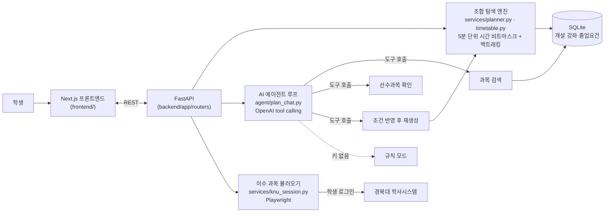

# Plann

**학교 로그인 한 번으로 이수 과목을 불러오고, 2026-2학기 시간표를 코드가 조합 탐색으로 짜 주며, AI 에이전트가 그 이유를 설명하고 대화로 고쳐 주는 경북대 컴퓨터학부 수강 설계 서비스입니다.**

## 문제

수강신청 전에 학생은 탭 여러 개를 오갑니다. 학사시스템에서 이수 성적을 확인하고, 졸업요건 문서에서 남은 전공·교양 학점을 세고, 수업시간표 조회 화면에서 분반 시간을 하나씩 옮겨 적으며 겹치는지 손으로 맞춰 봅니다. 선수과목은 또 다른 문서에 있습니다. 조건 하나("금요일은 비우고 싶다")가 바뀌면 이 과정을 처음부터 다시 합니다.

## 핵심 기능

1. **학교 로그인으로 이수 과목 불러오기**: Plann 화면에 아이디·비밀번호를 넣으면 서버가 띄운 브라우저(Playwright)가 학교 화면에서 이수성적 조회까지 이동해 과목코드·과목명·학점·이수구분만 읽어 옵니다. 직접 입력이나 붙여넣기도 됩니다.
2. **조건으로 시간표 자동 생성**: 학점 범위, 꼭 넣을 과목, 공강 요일, 비울 시간을 고르면 코드가 2026-2 개설 강좌(분반 781개)에서 시간이 겹치지 않는 조합을 찾아 후보를 점수순으로 보여 줍니다. 다 지킬 수 없으면 빠진 과목과 이유, 대안을 함께 돌려줍니다.
3. **'나의 시간표' AI 에이전트**: 왜 이렇게 짰는지 설명하고, "운영체제 빼줘", "금요일 비워줘" 같은 말을 조건 수정으로 바꿔 시간표를 다시 만듭니다. 과목 검색, 선수과목 확인, 조건 반영 후 재생성을 도구로 호출합니다(OpenAI tool calling).
4. **졸업요건·선수과목 안내**: 트랙별(심컴·인컴·첨컴·플솦·글솦) 졸업요건과 선후수 과목을 불러온 이수 과목과 함께 보여 줍니다. 참고용이며 공식 졸업사정은 아닙니다.
5. **키 없이도 동작**: OpenAI 키가 없으면 자주 쓰는 말을 규칙으로 알아듣는 규칙 모드로 동작합니다. 시간표 생성은 원래 AI를 쓰지 않습니다.

## 구조



- **조합 탐색 엔진** (`backend/app/services/timetable.py`): 분반의 수업 시간을 요일×5분 칸의 비트마스크로 바꿔 `&` 한 번으로 충돌을 검사하고, 백트래킹으로 조합을 탐색합니다. 꼭 넣을 과목을 먼저 고정하고, 남은 학점으로 교과구분별 최소 학점을 채울 수 없는 가지는 잘라냅니다. 선택 과목이 40개 이하이고 탐색이 노드 한도(5,000) 안에 끝나면 모든 경우를 따진 것이고, 그렇지 않으면 과목 일부를 뽑아 짧게 탐색하기를 80번 되풀이합니다(난수 시드 고정이라 같은 요청에는 같은 결과). 찾은 조합은 공강 요일, 목표 학점, 빈 시간 등으로 점수를 매기고, 분반만 다른 비슷한 시간표는 뒤로 미룹니다.
- **조건 변환** (`backend/app/services/planner.py`): 프론트의 "반드시 / 가능하면" 조건을 엔진 조건으로 바꾸고, 후보(`tt_001`…)와 빠진 과목의 이유, 대안을 만듭니다.
- **AI 에이전트** (`backend/app/agent/plan_chat.py`, `POST /tools/chat`): 학생의 말을 해석해 도구를 고르고, 결과를 보고 답합니다. 시간표 자체는 언제나 엔진이 다시 만듭니다.

## 원칙: AI는 지어내지 않는다

- **조합과 검증은 코드, 해석과 설명은 AI.** 시간 충돌, 학점 합, 개설 여부는 코드가 계산합니다. AI가 고친 조건도 같은 엔진을 다시 거치므로, 대화로 바꾼 시간표에도 겹치는 시간이나 개설되지 않은 과목이 들어가지 않습니다.
- AI가 개설 강좌에 없는 과목을 말하면 버리고, 조건에 맞는 시간표가 없으면 적용하지 않고 이유를 답합니다.
- 졸업요건 충족 여부는 판정하지 않습니다. 2025 교육과정 기준 참고용입니다.

## 3분 실행

Python 3.10 이상, Node.js 20 이상이 필요합니다. 터미널 두 개를 엽니다.

```bash
# 1) 백엔드: http://localhost:8000 (API 문서 /docs)
cd backend
python -m venv .venv && source .venv/bin/activate   # Windows: .venv\Scripts\Activate.ps1
pip install -r requirements.txt
cp .env.example .env        # 선택: OPENAI_API_KEY, OPENAI_MODEL 을 채우면 AI 모드
uvicorn app.main:app --reload
```

```bash
# 2) 프론트엔드: http://localhost:3000
cd frontend
npm ci
npm run dev
```

- `.env`에 `OPENAI_API_KEY`와 `OPENAI_MODEL`이 없으면 챗봇은 **규칙 모드**로 동작합니다("빼줘", "넣어줘", "금요일 비워줘", "아침 수업 싫어", "18학점" 등). 시간표 생성은 키와 상관없이 동작합니다.
- 학교 로그인 불러오기를 쓰려면 추가로 `pip install -r requirements-import.txt` 와 Chrome(또는 `python -m playwright install chromium`)이 필요합니다. 아래 [경북대 이수 과목 불러오기](#경북대-이수-과목-불러오기-실험-기능) 참고.
- 테스트: `cd backend && python -m pytest -q` (Playwright 없이도 돌고, 진짜 브라우저가 필요한 테스트만 건너뜁니다). GitHub Actions(`.github/workflows/ci.yml`)가 push·PR마다 백엔드 테스트와 프론트 lint·build를 돌립니다.

## 팀

| 이름 | 역할 |
|---|---|
| 송승록 | PM, 백엔드·에이전트 |
| 김정헌 | 백엔드·에이전트 |
| 조가연 | 프론트엔드·데이터 |
| 김재영 | 프론트엔드·데이터 |

## 안전: 학교 계정을 다루는 방법

학교 로그인 불러오기는 학교의 공식 API가 아니라 서버가 띄운 브라우저로 학교 화면을 조작하는 방식이라, 학생의 계정 정보가 우리 서버를 거칩니다. 그래서 다음을 지킵니다 (`backend/app/services/knu_session.py`, `backend/app/routers/knu_import.py`).

- **동의 먼저**: 화면에서 필수 동의 두 개에 체크해야 시작 버튼이 켜지고, 서버도 `consent`가 없으면 연결을 열지 않습니다(400).
- **비밀번호 미저장**: 아이디·비밀번호는 학교 로그인 칸을 채우는 함수 안에서만 쓰고 세션에도, 파일에도, 로그에도 남기지 않습니다. 요청 본문과 예외 내용도 로그·응답에 싣지 않습니다.
- **읽은 뒤 바로 닫기**: 이수성적 응답을 읽으면 학교 세션(쿠키)을 담은 학생별 브라우저 창을 즉시 닫습니다. 읽은 과목(코드·이름·학점·이수구분)만 메모리에 두었다가 연결을 끊으면 지웁니다. 10분 미사용, 30분 경과 시에도 자동으로 닫습니다.
- **격리와 제한**: 학생마다 브라우저 컨텍스트를 따로 만들고 추측할 수 없는 토큰으로 구분합니다. `knu.ac.kr` 밖으로 이동하면 되돌리고, 기본으로 서버를 실행한 컴퓨터에서 온 요청만 받으며, 다른 사이트의 요청은 출처(Origin) 검사로 막습니다.
- **공개 배포에서는 끔**: `KNU_IMPORT_ENABLED=0`. 실제 학교 계정으로 전체 과정을 검증하지는 않았습니다(아래 "확인한 것과 확인하지 못한 것").

## 문서

- [docs/api-contract.md](docs/api-contract.md): 프론트엔드와 백엔드 사이 API 모양
- [docs/planning/](docs/planning/): 11/16 기획 문서 ([기능 범위](docs/planning/scope.md), [대표 시나리오](docs/planning/scenarios.md), [에이전트 도구 정의](docs/planning/agent-tools.md)). 이후 바뀐 점은 각 문서 첫 줄에 적었습니다.

---

# 개발 문서

## 폴더 구조

```
backend/
  app/
    main.py        # FastAPI 서버 시작점
    routers/       # API 엔드포인트
    agent/         # 에이전트 로직 (LLM 호출, 도구 사용)
    services/      # 시간표 조합 탐색, 조건 변환, 이수 과목 불러오기
    data/          # 시간표, 졸업 요건 데이터
    schemas.py     # 과목 데이터 형식
    db.py          # 데이터베이스 테이블과 읽기·쓰기
    static/        # 시연용 화면 (index.html)
  scripts/         # 데이터 변환 스크립트
  requirements-import.txt  # 이수 과목 불러오기(실험 기능)용 추가 패키지
  tests/           # 테스트
  requirements.txt
  .env.example
frontend/          # Next.js 프론트엔드 (Plann). 실행법은 frontend/README.md
docs/              # API 계약, 기획 문서
.github/workflows/ # CI (백엔드 테스트, 프론트 lint·build)
```

## 백엔드 실행 방법

Python 3.10 이상과 git이 필요합니다.

### 1. 코드 받기

```bash
git clone https://github.com/rlawjdgjs877/course-planner-agent.git
cd course-planner-agent/backend
```

### 2. 가상환경 만들고 켜기

Windows (PowerShell):

```powershell
python -m venv .venv
.venv\Scripts\Activate.ps1
```

macOS / Linux:

```bash
python3 -m venv .venv
source .venv/bin/activate
```

켜지면 터미널 줄 앞에 `(.venv)`가 붙습니다.

> Windows에서 "스크립트를 실행할 수 없습니다" 오류가 나면
> `Set-ExecutionPolicy -Scope CurrentUser RemoteSigned` 를 한 번 실행한 뒤 다시 시도하세요.

### 3. 패키지 설치

```bash
pip install -r requirements.txt
```

### 4. 환경변수 파일 만들기

`.env.example`을 복사해 `.env`를 만들고 `OPENAI_API_KEY=` 뒤에 키를, `OPENAI_MODEL=` 뒤에 사용할 모델 이름을 넣습니다. 채팅 기능에만 필요하고, 없어도 시간표 만들기는 동작합니다.

Windows (PowerShell):

```powershell
Copy-Item .env.example .env
```

macOS / Linux:

```bash
cp .env.example .env
```

**`.env`는 절대 커밋하지 마세요.** `.gitignore`에 들어 있어 기본적으로 올라가지 않습니다.

### 5. 서버 실행

```bash
uvicorn app.main:app --reload
```

### 6. 확인

- 시간표 화면: http://localhost:8000
- API 문서: http://localhost:8000/docs
- 상태 확인: http://localhost:8000/health → `{"status": "ok"}`

서버를 끄려면 터미널에서 `Ctrl + C`를 누릅니다.

## API

| 주소 | 설명 |
|---|---|
| `GET /` | 시연용 화면 (`backend/app/static/index.html`). 조건을 고르면 시간표 화면으로 넘어가고, 그 아래 채팅으로 고칠 수 있음 |
| `POST /tools/chat` | '나의 시간표' 챗봇. 지금 후보를 설명하거나 말대로 조건을 고쳐 다시 만듦. 키가 없거나 AI 호출이 실패하면 규칙 모드 |
| `POST /chat` | 시연용 화면(`localhost:8000`)의 채팅. 예: "세계의 문화 추가해줘", "운영체제 빼줘". OpenAI 키 필요 |
| `/import/knu/*` | 경북대 이수 과목 불러오기 (실험 기능, 기본 켜짐). 아래 설명 참고 |
| `POST /tools/generate_timetable` | 에이전트 도구 정의 v3.2 형식의 시간표 생성 (프론트엔드용). 자세한 모양은 `docs/api-contract.md` |
| `GET /tools/candidates/{id}` | 앞서 만든 후보(tt_001, tt_alt_001) 다시 가져오기 |
| `GET /health` | 서버 상태 확인 |
| `GET /courses` | 이번 학기 개설 강좌 전체. `sample`이 `true`이면 가짜 샘플 데이터 |
| `POST /timetables` | 조건에 맞고 시간이 겹치지 않는 시간표를 점수순으로 반환 |

### POST /timetables

AI를 쓰지 않는 계산이라, 돌려주는 시간표는 항상 시간 충돌이 없고 학점 조건을 지킵니다. http://localhost:8000/docs 에서 바로 실행해 볼 수 있습니다.

요청 예시:

```json
{
  "min_credits": 12,
  "max_credits": 15,
  "must_include": ["SAMP0201"],
  "completed": [],
  "exclude": [],
  "blocked_times": [{ "start": "09:00", "end": "10:00" }, { "day": "수", "start": "13:00", "end": "18:00" }],
  "required_credits": { "전공필수": 3 },
  "preferred_free_days": ["금"],
  "max_results": 3
}
```

| 항목 | 의미 |
|---|---|
| `min_credits`, `max_credits` | 이번 학기 학점 범위 (필수) |
| `must_include` | 꼭 넣을 과목. 교과목코드 또는 교과목명 |
| `completed`, `exclude` | 이미 이수한 과목, 넣지 않을 과목 |
| `blocked_times` | 수업을 넣으면 안 되는 시간. `day`를 비우면 모든 요일 |
| `required_credits` | 교과구분별로 이번 학기에 채울 최소 학점 |
| `exclude_full` | 정원이 찬 강좌 제외 여부 |
| `preferred_free_days` | 공강이면 좋은 요일. 반드시 지켜지지는 않고 점수에 반영 |

응답의 `timetables`는 점수가 높은 순입니다. 조건을 만족하는 시간표가 없으면 `timetables`가 비고 `message`에 이유가 담깁니다. `truncated`가 `true`이면 경우의 수가 많아 전부 따져 보지는 못했다는 뜻입니다 (결과는 여전히 모두 유효합니다).

`app/data/courses.json`이 없으면 가짜 샘플 데이터(`courses.sample.json`)로 동작합니다.

### POST /chat

AI는 사용자의 말을 이해해 **조건만** 고치고, 시간표는 `POST /timetables`와 같은 코드가 다시 만듭니다. 그래서 채팅으로 바꿔도 시간이 겹치거나 개설되지 않은 과목이 들어가지 않습니다.

1. 화면이 지금 조건(`request`), 보고 있는 시간표의 강좌번호(`current_course_ids`), 사용자의 말(`message`)을 보냅니다.
2. AI가 고친 조건을 돌려줍니다. 개설 강좌에 없는 과목이나 형식이 틀린 시간은 버립니다.
3. 고친 조건으로 시간표를 다시 만듭니다. 지금 시간표의 과목은 가능하면 유지합니다.
4. 조건에 맞는 시간표가 없으면 적용하지 않고 이유를 답합니다.

`backend/.env`에 `OPENAI_API_KEY`와 `OPENAI_MODEL`이 둘 다 있어야 동작합니다. 없으면 503과 함께 안내 문구를 돌려줍니다. 관련 코드는 `backend/app/agent/chat.py`에 있습니다.

## 프론트엔드와 연결

프론트엔드(`frontend/`, Plann)가 부를 API의 요청·응답 모양은 [docs/api-contract.md](docs/api-contract.md)에 있습니다. 필드 이름은 프론트엔드의 `PlanningConstraints`와 같습니다.

실제 2026-2학기 개설 강좌(781개 분반)는 프론트엔드 팀이 모은 학교 조회 응답 원본(`frontend/data/course-sources/*.json`)에서 가져옵니다. 원본이 바뀌면 `backend` 폴더에서 다시 넣고, 함께 바뀌는 `backend/app/data/courses.json`을 커밋합니다.

```bash
python -m scripts.import_data offerings ../frontend/data/course-sources
```

## 데이터베이스

개설 강좌와 졸업 요건은 SQLite 데이터베이스(`backend/app/data/planner.db`)에 들어 있습니다. SQLite는 파일 하나가 곧 데이터베이스라서 따로 설치하거나 켤 것이 없습니다.

| 테이블 | 내용 |
|---|---|
| `courses` | 개설 강좌 (분반 단위): 강좌번호, 과목명, 교과구분, 학점, 교수, 강의실, 정원 등 |
| `meetings` | 강좌별 수업 시간: 요일, 시작, 종료. 주 2회 수업이면 두 줄 |
| `programs` | 학과·입학연도별 졸업 총 학점 |
| `credit_requirements` | 영역(교과구분)별 최소 학점 |
| `required_courses` | 꼭 들어야 하는 과목 |

테이블 정의와 읽고 쓰는 코드는 `backend/app/db.py`에 있습니다.

**DB 파일은 git에 올리지 않습니다.** 서버가 처음 DB에 연결할 때 테이블을 만들고, 비어 있으면 `app/data`의 원본 파일로 채웁니다.

- `courses.json`, `requirements.json`이 있으면 그것으로 채웁니다.
- 없으면 가짜 샘플(`courses.sample.json`, `requirements.sample.json`)로 채웁니다.

그래서 팀원은 `git pull`만 하고 서버를 켜면 같은 DB가 만들어집니다. DB를 처음부터 다시 만들고 싶으면 `planner.db` 파일을 지우고 서버를 다시 켭니다.

### 자료 넣기

`backend` 폴더에서 가상환경을 켠 상태로 실행합니다.

```bash
python -m scripts.import_data courses 저장한파일.xlsx
```

```bash
python -m scripts.import_data requirements 졸업요건.json
```

```bash
python -m scripts.import_data status
```

- `courses`: 엑셀, CSV, JSON을 읽어 강좌를 넣습니다. 같은 연도·학기의 기존 강좌는 새 것으로 바뀌고, 가짜 샘플이 들어 있었다면 지워집니다.
- `requirements`: 졸업 요건을 넣습니다. 형식은 `app/data/requirements.sample.json`을 따릅니다.
- `status`: 지금 들어 있는 자료의 개수를 보여 줍니다.

넣은 자료는 `app/data/courses.json`, `requirements.json`으로도 저장됩니다. **이 JSON 파일을 커밋해서 올려야** 팀원에게 같은 자료가 전달됩니다.

### 조회 API

| 주소 | 설명 |
|---|---|
| `GET /courses?q=자료&category=교양&department=컴퓨터학부` | 강좌 검색. 조건은 모두 선택 사항 |
| `GET /requirements?department=컴퓨터학부&admission_year=2024` | 졸업 요건 |

## 과목 데이터 만들기 (데이터 담당)

데이터 형식은 `backend/app/schemas.py`의 `Course`입니다.

학교 시간표 사이트는 `robots.txt`로 자동 수집을 금지하고 있습니다. **프로그램으로 긁어 오지 말고**, 사람이 직접 조회한 결과를 옮기거나 학교에서 제공받은 파일을 사용합니다.

### 1. 표를 파일로 옮기기

1. 학교 '수업시간표 및 강의계획서 조회' 화면에서 필요한 학과·교양을 조회합니다.
2. 결과 표를 열 제목까지 포함해 엑셀에 붙여넣고 `.xlsx` 또는 `.csv`로 저장합니다.
3. 여러 번 조회했다면 한 시트에 이어 붙입니다. 같은 강좌번호는 한 번만 남습니다.

최소한 `강좌번호`, `교과목명`, `학점` 열이 있어야 하고, 시간 충돌 검사를 하려면 `강의시간` 또는 `강의시간(실제시간)` 열이 필요합니다. 열 순서는 상관없습니다.

### 2. 데이터베이스에 넣기

`backend` 폴더에서 가상환경을 켠 상태로 실행합니다.

```bash
python -m scripts.import_data courses 저장한파일.xlsx
```

데이터베이스에 들어가고 `app/data/courses.json`도 함께 만들어집니다. 해석하지 못한 줄이 있으면 경고로 알려 줍니다. `courses.json`을 커밋해서 올리면 팀원도 같은 과목을 쓰게 됩니다.

### 샘플 데이터

`app/data/courses.sample.csv`와 `courses.sample.json`은 형식을 보여 주는 **가짜 데이터**입니다. 실제 데이터가 준비되기 전까지 개발과 테스트에 씁니다.

### 테스트

```bash
python -m pytest
```

## 경북대 이수 과목 불러오기 (실험 기능)

조건 화면의 첫 항목 **이수 과목**에서 이미 들은 과목을 넣으면 시간표에서 뺍니다. 넣는 방법은 세 가지입니다.

- 직접 입력: 과목코드, 과목명, 학점, 이수구분을 한 과목씩 추가
- 붙여넣기: 한 줄에 한 과목씩 `과목코드 과목명 3학점 이수구분` 형식
- 학사시스템에서 불러오기: 아래의 실험 기능 (켜져 있을 때만 보임)

목록은 학생 브라우저의 탭 저장소(sessionStorage)에만 두고 서버에 저장하지 않습니다. 시간표에서 이미 들은 과목을 빼는 데만 쓰며, **졸업 요건 충족 여부를 판정하지 않습니다.**

### 무엇을 하는 기능인가

학교의 공식 API 연동이 아니라, **서버가 띄운 브라우저(Playwright)로 학교 화면을 자동 조작하는 실험 기능**입니다. 학교 조회 요청을 우리 사이트에서 직접 보내는 방식은 CORS 때문에 막혀서 이 방식을 씁니다.

1. 학생이 안내를 읽고 동의하면, 서버가 학생 한 명을 위한 브라우저 창(컨텍스트)을 열고 학교 화면을 엽니다.
2. 학생이 로그인합니다. Plann 프론트에서는 학교 화면을 보여 주지 않고 아이디·비밀번호 칸만 띄웁니다. 서버가 그 값으로 학교 로그인 칸을 채워 제출합니다(`POST /import/knu/login`, 값은 저장·기록하지 않음). 백엔드 시험 페이지(`localhost:8000`)에서는 화면을 이미지로 보여 주고 학생의 클릭과 입력을 전달하는 방식도 그대로 쓸 수 있습니다.
3. 로그인이 끝나면(화면에 비밀번호 칸이 사라지면) 통합정보시스템 왼쪽 아래의 `성적 → 학기성적 → 이수성적 조회`만 차례로 누르고, 1.5초 안에 응답이 없으면 `조회` 버튼까지 자동으로 누릅니다. 0.1초마다 화면을 확인하고, 클릭이 실패하면 1초 뒤 다시 눌러서, 로그인 뒤 보통 몇 초 안에 끝납니다. 로그인 전에는 아무것도 누르지 않고, 공지 팝업 창이 떠도 모든 창에서 메뉴를 찾습니다.
4. 학교가 보내는 조회 응답(주소에 `searchTotalGradsInqrList` 포함)의 `data`에서 `gradsGradCd`가 F, NP인 과목을 빼고, `sbjetCd`, `sbjetNm`, `crdit`, `sbjetSctnm`만 읽습니다.
5. 과목을 다 읽으면 학교 세션(쿠키)을 담은 브라우저를 바로 닫습니다. 학생이 목록을 확인하고 이수 과목에 넣으면 연결을 끊습니다.

**학생의 아이디, 비밀번호, 로그인 뒤 학교 세션이 서비스가 운영하는 브라우저를 거칩니다.** 화면에도 이 내용을 안내하고 동의를 받습니다.

### 지키는 것

- 비밀번호, 쿠키, 세션, 성적 원문, 화면 캡처를 파일이나 로그에 남기지 않습니다. 읽은 과목만 메모리에 두었다가 연결을 끊으면 지웁니다. 입력 요청의 내용은 로그에 쓰지 않고, 연결 토큰은 주소가 아니라 헤더로 주고받습니다.
- 학생마다 브라우저 컨텍스트(쿠키, 저장소)를 따로 만들고, 추측할 수 없는 토큰으로 구분합니다.
- 연결 종료, 페이지 닫기, 10분 미사용, 30분 경과 중 하나가 되면 컨텍스트를 닫습니다. 다음 연결을 빠르게 하려고 Chrome 프로그램 자체는 이수 과목 화면을 열 때 미리 띄우고, 마지막 연결이 끝난 뒤 10분 동안 켜 둡니다. 이때 학생별 창(쿠키, 기록)은 이미 지워진 상태입니다.
- 원격 브라우저가 허용한 주소(기본 `knu.ac.kr`과 그 하위 주소) 밖으로 이동하면 바로 이전 화면으로 되돌리고, 새 창이면 닫습니다. 요청을 미리 가로채는 방식은 페이지를 크게 느리게 해서 쓰지 않습니다.
- 다른 사이트가 학생의 브라우저를 이용해 이 API를 부르지 못하게 출처(Origin)를 확인합니다.

### 켜는 법 (로컬에서만)

```bash
pip install -r requirements-import.txt
```

Google Chrome이 설치되어 있어야 합니다. 없으면 Playwright용 Chromium을 받습니다.

```bash
python -m playwright install chromium
```

이 기능은 기본으로 켜져 있습니다. 끄려면 `backend/.env`에 아래 한 줄을 넣고 서버를 다시 켭니다. **공개 배포에서는 반드시 끄세요.**

```
KNU_IMPORT_ENABLED=0
```

켜져 있어도 **서버를 실행한 컴퓨터에서 접속한 요청만** 받습니다. `http://localhost:8000`에서 이수 과목 항목 아래에 "경북대 학사시스템에서 불러오기"가 나타납니다.

| 환경변수 | 기본값 | 설명 |
|---|---|---|
| `KNU_IMPORT_ENABLED` | 켜짐 | `0`이면 끄기 (공개 배포 시 필수) |
| `KNU_IMPORT_ALLOW_REMOTE` | 꺼짐 | `1`이면 다른 컴퓨터의 접속도 받기. 보안 검토 전에는 켜지 말 것 |
| `KNU_IMPORT_START_URL` | 학사시스템 메인 | 처음 여는 주소 |
| `KNU_IMPORT_ALLOWED_HOSTS` | `knu.ac.kr` | 원격 브라우저가 이동할 수 있는 주소 (쉼표로 구분) |
| `KNU_IMPORT_BROWSER_CHANNEL` | `chrome` | 비우면 Playwright의 Chromium 사용 |
| `KNU_IMPORT_MAX_SESSIONS` | 3 | 동시에 열 수 있는 연결 수 |
| `KNU_IMPORT_IDLE_SECONDS` | 600 | 이만큼 요청이 없으면 연결을 닫음 |
| `KNU_IMPORT_MAX_SECONDS` | 1800 | 연결의 최대 사용 시간 |

### 잘 안 될 때

- **자동 이동이 안 될 때**: 메뉴 이름이 다르거나(지금은 `성적`, `학기성적`, `이수성적 조회`를 찾고, `성적`이 3번 안 펼쳐지면 `학사행정`을 한 번 눌러 봄) 화면 구조가 달라서일 수 있습니다. 이수성적 조회를 3번 열고 조회 버튼을 눌러도 응답이 없으면 자동 이동을 멈춥니다. 원격 화면에서 메뉴를 직접 눌러 이수성적 조회를 열면 됩니다. 응답을 읽는 것은 메뉴를 누가 눌렀는지와 상관없습니다. "자동 이동 다시 시도"를 눌러도 됩니다.
- **추가 인증, 팝업, 보안 프로그램 설치 요구**: 원격 화면에서 직접 진행해 보고, 안 되면 연결을 종료하고 직접 입력이나 붙여넣기를 씁니다.
- **한글 입력, 휴대폰 키보드**: 원격 화면에 직접 치는 대신 화면 아래 입력칸에 적고 "보내기"를 누릅니다. 비밀번호도 이 칸을 쓰면 가려진 채로 보낼 수 있습니다.
- **응답 형식이 다를 때**: "조회 응답을 읽지 못했습니다"가 나옵니다. 이때도 응답 내용은 남기지 않습니다.

### 확인한 것과 확인하지 못한 것

- 실제 학교 계정으로는 확인하지 않았습니다. 학교의 메뉴 이름, 로그인 방식, 응답 형식이 바뀌면 동작하지 않을 수 있습니다.
- 재이수, 이수 취소 등 F/NP 외의 경우는 검증하지 않았습니다. 같은 과목코드가 여러 번 나오면 하나만 남기고 화면에서 확인을 부탁합니다.
- `tests/test_knu_browser.py`는 진짜 Chrome으로 **가짜 학교 페이지**를 열어 로그인 입력, 자동 메뉴 이동, 응답 읽기, 주소 제한, 세션 분리, 정리를 확인합니다. Playwright나 Chrome이 없으면 건너뜁니다.

### 공개하기 전에

이 기능을 다른 학생에게 열면, 학생들의 학교 계정 정보가 우리가 운영하는 서버를 거치게 됩니다. 학교 이용 약관과 보안 정책, 해커톤 운영 측의 확인 없이 `KNU_IMPORT_ALLOW_REMOTE`를 켜거나 공개 배포하지 마세요. HTTPS, 서버 접근 통제, 보안 검토가 먼저 필요합니다.

## 협업 규칙

- `main`에 직접 push하지 말고, 브랜치를 만들어 Pull Request로 올립니다.
- 작업 시작 전에 `git pull`로 최신 코드를 받습니다.
